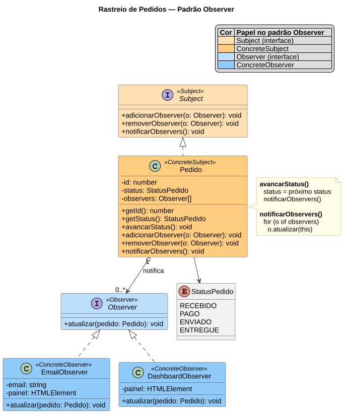

# Rastreio de Pedidos - Padrão Observer

Trabalho da **AD1** da disciplina de **Padrões de Projeto** (UDESC/CEAD — Tecnologia em Análise e Desenvolvimento de Sistemas).

O sistema simula o rastreio de um pedido de uma loja virtual. Sempre que o pedido muda de status, os interessados (o e-mail do cliente e o painel da loja) são avisados automaticamente. O exemplo foi feito para mostrar o padrão de projeto **Observer**.

> **Observer:** definir uma dependência um-para-muitos entre objetos para que, quando um objeto mudar de estado, os seus dependentes sejam notificados e atualizados automaticamente.

A descrição completa do sistema e de como o padrão resolve o problema está na [Wiki do projeto](https://github.com/anaalthoff/padroes-de-projeto/wiki).

## Como executar

1. Clone ou baixe o repositório:
   ```
   git clone https://github.com/anaalthoff/padroes-de-projeto.git
   ```
2. Abra o arquivo `index.html` em qualquer navegador.

Não é preciso instalar nada nem iniciar um servidor: o projeto usa apenas HTML, CSS e JavaScript puro.

## Como usar

- **Avançar status:** o pedido passa pelas etapas `RECEBIDO` → `PAGO` → `ENVIADO` → `ENTREGUE`. A cada mudança, os observers inscritos são avisados.
- **E-mail inscrito / Dashboard inscrito:** marque ou desmarque para inscrever ou cancelar a inscrição de cada observer, com o sistema rodando.

Os dois observers reagem ao mesmo aviso de formas diferentes:

- **E-mails enviados:** acumula uma mensagem para cada mudança, formando um histórico.
- **Dashboard da loja:** mostra apenas o status atual do pedido.

## Diagrama de classes



O código-fonte do diagrama, em PlantUML, está em [`docs/diagrama-classes.puml`](docs/diagrama-classes.puml).

## Papéis do padrão no código

| Papel no padrão | Classe | Arquivo |
|---|---|---|
| Subject | `Subject` | [`js/Subject.js`](js/Subject.js) |
| Observer | `Observer` | [`js/Observer.js`](js/Observer.js) |
| ConcreteSubject | `Pedido` | [`js/Pedido.js`](js/Pedido.js) |
| ConcreteObserver | `EmailObserver` | [`js/EmailObserver.js`](js/EmailObserver.js) |
| ConcreteObserver | `DashboardObserver` | [`js/DashboardObserver.js`](js/DashboardObserver.js) |
| Apoio | `StatusPedido` | [`js/StatusPedido.js`](js/StatusPedido.js) |

O arquivo [`js/app.js`](js/app.js) cria o pedido, inscreve os observers e liga os botões da página.

Como o JavaScript não possui `interface`, `Subject` e `Observer` são classes base cujos métodos lançam um erro se não forem implementados pelas subclasses.

## Estrutura do projeto

```
├── index.html               página principal
├── style.css                estilo da página
├── docs/
│   ├── diagrama-classes.puml  diagrama de classes (PlantUML)
│   └── diagrama-classes.svg   diagrama de classes (imagem)
└── js/
    ├── Subject.js           interface Subject
    ├── Observer.js          interface Observer
    ├── StatusPedido.js      status possíveis e sua ordem
    ├── Pedido.js            ConcreteSubject
    ├── EmailObserver.js     ConcreteObserver (e-mail)
    ├── DashboardObserver.js ConcreteObserver (dashboard)
    └── app.js               cria os objetos e liga a página
```
